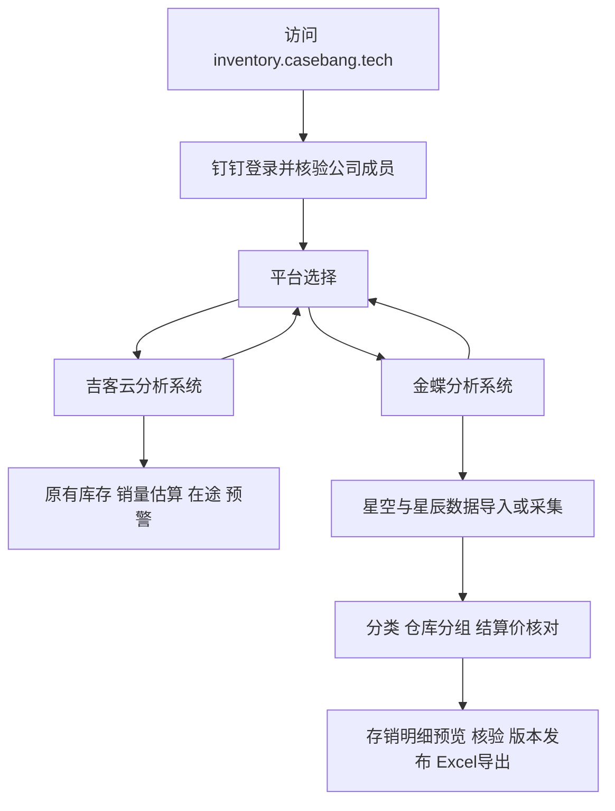

# 双平台库存分析与金蝶存销项目方案

版本：V1.6（2026年10月22日接入星空连接与20行探测，全量待联调）
制定日期：2026年10月19日  
网站入口：https://inventory.casebang.tech/  
范围：记录已确认的产品结构、金蝶统计规则、目标表制作流程和后续开发顺序。

在现有网站上共用钉钉登录。登录后选择“吉客云”或“金蝶”，分别进入两个独立的数据分析系统。吉客云继续提供现有仓库分析；金蝶整合星空与星辰数据，逐步制作 `casebang 存销明细 2026.10.09.xlsx` 中的目标报表，第一阶段优先完成“明细”工作表。

本文中的“已确认”表示用户确定的需求或规则，“现有实现”表示本地已有代码或核对结果，“拟实施”表示下一阶段开发方案。本地已实现平台入口、金蝶独立业务库、Excel上传、92列网格复现、原表对照、仓库维护与重算、历史批次及导出。本轮以复现雏形优先；历史年月、统一时点、门店差异与退货规则、价格缺口及单位有效期、新商品四维与POD含义均按用户要求暂缓，不作为雏形阻塞条件。历史统计口径的完整核验及自动采集继续留待后续。本次未部署生产，使用说明见[金蝶雏形](./金蝶雏形使用说明.md)。

## 一 产品入口与使用流程

### 1.1 登录后选择平台

标准流程为：

平台选择页展示“吉客云”“金蝶”两个入口。星空和星辰是金蝶系统内部的两种数据来源，不再拆成第三、第四个平台入口。

选择页本身不触发库存采集、文件解析、历史重算或消息发送。没有金蝶数据的新用户进入金蝶后显示导入入口；不会将吉客云仓库或历史自动复制过去。

两个系统顶部均提供“切换平台”，返回选择页，不退出钉钉登录。切换时清理当前平台的筛选和页面请求状态，按目标平台重新读取数据。

登录完成默认进入平台选择页。平台偏好可以用于突出上次选择，第一阶段不据此静默跳过选择。已有报告链接可保留经过校验的站内目标，用户选中对应平台后再返回该目标，不能开放任意外部跳转。

### 1.2 共用登录与账户能力

沿用本网站现有公司钉钉身份、账户状态、管理员身份和会话校验，不为两个平台另建两套登录账号。

现有会话策略为钉钉默认记住30天，并在有效访问时续期；公司成员状态仍按现有机制重新核验。主动退出、管理员撤销会话、账户禁用等规则继续生效。切换平台不重新扫码，退出登录同时退出两个平台。

同一账户在两个平台中有独立业务空间。现有普通账户之间的数据隔离继续沿用；管理员跨账户访问必须明确目标账户并保留操作审计。平台选择不是新增的数据授权，不能通过改网址、平台参数或账户ID访问其他账户的数据。

吉客云已有仓库分享按原规则保留，不自动变成金蝶数据分享。金蝶跨账户共享与协作范围尚未确认，第一阶段按账户独立管理，管理员沿用受控管理视图。

## 二 两个平台的独立边界

### 2.1 共用部分

- 网站域名、HTTPS和登录入口。
- 钉钉身份、账户状态、管理员身份、会话续期和退出机制。
- 基础界面组件，以及不含业务含义的日期、精确数量、文件校验等通用工具。

### 2.2 分别保存和运行的部分

- 数据源凭证及其使用范围。
- 仓库目录、分组、商品主档及分类字典。
- 库存、销售、价格、历史批次和计算结果。
- 导入、采集、重算、导出任务及失败记录。
- 统计口径、规则版本、报表版本、预警和通知设置。
- 业务缓存、任务锁、去重键、原始文件、生成文件及其访问权限。

平台标识固定使用 `jackyun` 和 `kingdee`。金蝶内部来源另用 `xingkong` 和 `xingchen` 标识。商品或仓库即使同名、同码，也不跨两个平台自动合并。

吉客云的“期初可订购库存＋区间实际入库－区间调拨出库－期末可订购库存”净销量估算，不用于计算金蝶直接来自销售报表的销量；金蝶价目表、分类规则也不改变吉客云已有指标。

### 2.3 数据隔离方案

保留现有`inventory.sqlite`及其账户、会话、吉客云业务数据，新增独立的`kingdee.sqlite`和原件区域`kingdee-files`。默认与现有库位于同一storage挂载目录，也可单独配置路径。没有迁移现有账户或业务记录。

金蝶业务记录保存当前账户的内部身份引用，并在服务端验证公共账户状态。两个SQLite文件之间不声明跨库外键；关联身份由授权服务检查。

所有金蝶业务查询、任务、缓存和导出都包含账户归属。文件下载必须回查所属导入批次或报表的账户与平台，不能仅凭一个文件ID放行。

## 三 金蝶系统的目标范围

### 3.1 第一阶段完成目标

用户要求优先复现原Excel：已按A—CN共92列保留原列顺序、宽度、底色及冻结，取消卡片式布局。G—CC留存原表历史缓存，CD—CN生成本批参考结果并明确标注本批；原表对照保留原92列表头与缓存，避免混淆历史时点。统计口径的暂缓项保持后续范围。

通过四份业务报表，加上结算价和商品资料，生成可查看、可追溯、可导出的存销明细。核心流程是：

1. 导入原始文件并核验数据范围、数量和结构。
2. 按物料编码整理商品主档与四个维度。
3. 汇总公司销量和门店销量。
4. 按可配置的内外仓名单计算公司库存，按确认的门店范围计算门店库存。
5. 匹配结算价，计算库存金额。
6. 显示缺价、未分类、仓库未归属、日期或口径不一致的记录。
7. 核验后发布报表版本，导出目标“明细”工作表。

第一阶段以“明细”A—CN共92列为主。类目占比、型号占比、IP占比可在明细稳定后，按统一数据计算扩展。原材料监控、电商成品监控、在途、未交和补单等页面若需要额外数据，另列数据来源与规则，不声称五份输入已经覆盖原Excel全部工作表。

### 3.2 五类输入

四份业务报表是数量来源，销售价目表是新增的价格来源：

1. **星空销售出库汇总报表**：公司销量。当前接口测试标识 `SAL_OutStockSummaryRpt`；按物料编码汇总“出库数量”。
2. **星空物料收发汇总表**：公司库存。当前接口测试标识 `STK_StockSummaryRpt`；使用物料编码、仓库和结存数量。
3. **星辰销售明细表**：门店销量。包含单据日期、类型、状态、商品编码、基本数量等；按R08所列查询条件导出，并核对源表对这些条件的覆盖。
4. **星辰库存查询表**：门店库存。使用商品、仓库和确认口径的库存数量。
5. **星空销售价目表**：结算价。用户已确认本次导出的“物料编码＋价格”为新批次结算价来源；按组织、币别、含税、状态和价目对象核对。

旧“明细”提供初始商品主档和历史值，包括类目、型号、POD、IP、物料名称等。仅凭当期有库存或有销售的四份报表，不能生成完整商品清单。

## 四 已确认的统计规则

### R01 公司销量使用出库数量

公司销量直接汇总星空销售出库汇总报表的“出库数量”，不使用“应收数量”替代。

“是否赠品”标记不参与筛选，标记为赠品、非赠品或空白的行均按出库数量计算。已有实现保留源数量正负号，不取绝对值、不把负数强行归零。

此前配置的六项客户名称“不包含”条件继续保留，不因本次更改赠品口径而新增或删除排除项：

- CASEBANG福田星河店。
- CASEBANG宝安壹方城店。
- CASEBANG武汉天地壹方南馆店。
- CASEBANG武汉万象城店。
- CASEBANG西安赛格店。
- casebang门店预定单。

这些条件与销售组织、日期范围分别留存。公司给门店供货与门店终端销售的统计边界，仍需结合旧表定义核对，不能仅因两种数据都叫“销量”就认定不存在重复统计。

### R02 内外仓名单可以扩充

2026年10月20日用户截图确认1个内仓、9个外仓，覆盖此前“初始5个、6个”的说明。全部名称与导出逐一匹配。完整名单见[雏形仓库范围](./金蝶雏形使用说明.md#本次确认的仓库范围)，网页和离线默认配置已录入，支持继续增减。

仓库支持明确归入“内仓”“外仓”或“排除”，同一仓库不能重复计入内外仓。雏形明确采用名单范围：名单外30个来源仓库保留范围说明，不并入本次公司结存；不能把该范围称为公司全部仓库库存。若后续切换全仓口径，未知归属仍需维护，不能按0掩盖。

此前“本地原料、本地成品、泰国两仓”的截图只作为业务背景，不代替10月20日明确名单。当前导出只有仓库名称，后续优先补充星空仓库编码；不把吉客云同名仓库编码自动认作星空编码。

调整分组后先预览影响，并保存新规则版本。已发布历史报表保留原名单与结果；需要重算时生成新版本。

### R03 保持四个维度 只扩充分类值

四个维度固定为类目、型号、POD标识、IP。当前需求是新增这些维度下的分类值，例如新类目、新型号、新IP，不是新增第五个维度。

每个维度维护自己的分类字典，并支持按商品指定分类。新增值不要求改代码或增加数据库列。新增商品或新分类值暂未维护时，保留商品并标为待维护，不丢弃、不自动归为“其他”。

优先使用明确维护的商品分类；已有旧主档值保留来源。星辰的大类、手机型号、IP等作为补充候选，未经确认的字段层级映射不覆盖已有值。空白、0、通用、非POD的含义分别处理，不能统一解释成同一类。

### R04 销售价目表作为结算价来源

用户提供的销售价目表已确认用于新批次结算价。按物料编码匹配“价格”，本次文件核对的属性为CASEBANG事业部、人民币、含税、按物料、已审核。

本次价目表编号为 `XSJMB1110`。编号、组织等属于可配置的来源范围，不把当前编号或文件名写成永久适用的业务规则。

同一编码存在不同价格、不同价目表或不一致属性时，列出冲突，不默认选第一条。完全相同的重复记录可合并，但保留全部源行。

价格缺失不填0；源文件明确为0的价格与空白价格分开保存。星辰赔付价、销售单价不替代结算价。

价目表未导出价格单位和有效期列。本次新价不自动覆盖旧表10月9日或其他历史时点的CK。274个与旧价不同的物料保留差异，不直接判断旧价错误；新批次使用所选价格版本，并显示对应来源。

### R05 物料编码作为关联主键

物料编码和商品编码以字符串保存。每份来源先按其业务维度汇总，再按编码关联，避免同商品多仓、多客户、多单据连接后重复放大数量。

目标商品范围以完整主档为基础，并保留业务来源新增编码。名称用于展示及核对，不作为唯一关联主键。仅出现在价目表、未进入主档或本次业务范围的编码，不自动全部加入明细。

异码、同码异名、单位差异进入维护清单。星空Pcs与星辰个、pcs、条等，需按物料确认单位与换算关系，不全局默认1比1。

### R06 日期与历史版本

销量按明确起止日期统计，库存按明确时点保存。月份必须使用“年＋月”，原表重复出现的9月不能直接合并。

本次星空销售汇总范围为10月1—31日，星辰销售为10月1—19日、已审核；星辰库存为10月19日即时库存。导入时照实记录，不能宣称这些文件已与旧表10月9日对齐。

星空销售汇总没有单据日期，不能从整月汇总中拆出10月1—8日；需按该期间重新查询或使用相应旧导出。历史可以先继承旧值，但应标记“历史导入值”，不等同于原始单据已重新核验。

### R07 缺失状态和发布完整性

区分真实0、无发生、不适用、缺资料、取数失败、价格冲突、仓库未归属和口径待核验。

导出数量空白仅在表头完整、全量行已读取且与唯一原表合计一致时，按该来源的显示0处理。空白价格不采用此规则。

允许先查看有效数据和待维护清单。存在缺价时可以显示可计算部分金额及缺价覆盖数，但不能把它命名为完整库存总金额；不能静默剔除异常商品后发布为完整报表。

### R08 星辰报表查询条件

用户已指定库存查询条件为：日期当天、即时库存、汇总依据“商品＋仓库”、全部仓库。报表运行时记录实际业务日期，不能永久固定为本次截图的2026年10月16日。

用户已指定本次销售查询条件为：2026年10月1—31日，销售出库单、销售退货单、委托代销结算单、委托结算退货单、零售出库、零售退货六种单据全选；审核状态全部、单据对账状态全部；按“单据日期＋单据编号”排序。后续起止日期可设置，其他查询条件随批次保存。

这些查询条件已经确认，不重复作为待选择项。截图中库存仓库分类实际选了26项，不直接证明覆盖账套全部仓库；需要核对分类与仓库清单。本次销售导出只出现已审核的零售结存单，需核对报表单据类型映射及是否覆盖所选范围，不能据此把目标条件改成“仅已审核零售”，或认定其他类型一定无数据。

## 五 明细工作表的制作逻辑

### 5.1 商品资料列

- A类目、B型号、CPOD标识、DIP：来自已维护主档、旧值及经过确认的来源映射。
- E物料编码：跨来源连接主键，保留完整商品范围。
- F物料名称：按编码取权威名称；同码异名不自动合并成新商品。

### 5.2 销量列

G—CF共26组，每组三列分别为公司销量、门店销量、合计销量。公司销量采用R01；门店销量按R08的查询范围、单据日期及核验后的数量规则汇总。合计公式为同一行“公司销量＋门店销量”。

原列位置保留，年份映射待确认：

- 第一段9—12月：G/H/I、J/K/L、M/N/O、P/Q/R。
- 中间一组1—6月：S/T/U、V/W/X、Y/Z/AA、AB/AC/AD、AE/AF/AG、AH/AI/AJ。
- 中间一组7—12月：AK/AL/AM、AN/AO/AP、AQ/AR/AS、AT/AU/AV、AW/AX/AY、AZ/BA/BB。
- 最近一组1—6月：BC/BD/BE、BF/BG/BH、BI/BJ/BK、BL/BM/BN、BO/BP/BQ、BR/BS/BT。
- 最近一组7—9月：BU/BV/BW、BX/BY/BZ、CA/CB/CC。
- 10月1—8日：CD/CE/CF。

历史年月不能用列名字符串“9月”直接作数据库唯一键。重导同一期间时更新对应数据版本，不把整期数量重复追加。

### 5.3 库存和金额列

- CG内仓结存：星空结存数量按物料编码与内仓配置汇总。
- CH外仓结存：星空结存数量按物料编码与外仓配置汇总。
- CI公司结存：CG＋CH。
- CJ门店结存：星辰所选门店仓库按编码汇总确认口径的库存数量。
- CK结算价：按物料编码匹配所选价格版本。
- CL公司结存金额：CI×CK。
- CM门店结存金额：CJ×CK。
- CN总金额：CL＋CM。

库存时点、价格版本、计价单位和币别随报表保存。按结算价估算的金额，不自动等同于ERP财务库存成本。

### 5.4 原表作为模板与核对资料

“明细”有40,578个不同物料、92列，其中30列为逐行公式，62列为主档或报表输入。逐商品加法、乘法保存值未发现与对应公式不一致。

原表G—BH共54列底部合计与全部商品行加总不同。例如G列公式仅为 `SUM(G2:G7066)`，保存合计3,123，整列商品行加总14,807。生成新表时按明确业务范围重建合计；如果旧合计有意统计子集，应先明确子集，不把旧合计直接当准确性基准。

完整逐列说明见本地研发资料：[92列规则更新版](../../金蝶存销分析/outputs/detail-column-review-20261019/明细92列数据来源与缺口分析_规则更新版.xlsx)。

## 六 数据获取与导入流程

### 6.1 当前阶段采用手动导出导入

先完成网页上传、核验、维护、计算和导出闭环。五类文件分别识别数据来源与用途，不能根据上传顺序直接拼表，也不能混用两个平台的Excel。

每份文件登记原始文件名、来源系统、表类型、工作表、导出条件、统计期间或库存时点、上传人、账户归属、文件哈希、表头版本、行数和核验结果。上传文件先留存原件，解析过程不修改原件，不执行其中的宏、公式或外部链接。

同一文件重复上传应提示已导入批次。需要按新规则重算时，复用原文件并创建新的计算版本，不重复累加业务数量。

导入、解析、核验、标准化、计算、待维护、预览、发布、导出分别记录状态。失败显示具体来源和原因，并保留原件及上次已发布结果。

### 6.2 星空后续接入现有接口

销售出库汇总和物料收发汇总已有独立接口测试脚本；库存接口已做20行真实探测，与当时Excel样本核对。尚不能把样本探测称为全量接口对账或网页接入完成。

接口来源和Excel来源最终写入同一金蝶标准化模型。每次保留组织、日期、过滤方案、分页及原始返回，数据更新引起的总数变化与重复页、缺页分别处理，不把历史16,334行等旧样本数当作未来固定返回行数。

销售价目表的自动采集方式另行确认，不猜测接口名称或请求字段。

### 6.3 星辰的阶段安排

公司当前不通过正式API授权服务获取星辰两张报表，第一阶段使用正式账套手动导出的库存查询表、销售明细表。

后续可在正常登录和报表导出权限下，测试浏览器自动设置条件、查询及下载文件。会话失效时提示重新登录，不能把登录页或失败返回当成空业务数据。网页内部查询或导出请求仅在实际验证后接入，不预设其地址及稳定性。

此前沙箱测试返回空数据，不等于正式账套无数据；沙箱凭证或测试结果不作为正式账套的数据来源。

### 6.4 星空在线采集与星辰Excel导入并行（2026-10-20分析）

用户提出：在前端输入星空账套ID、用户名及密码，采集后分析；星辰两份报表暂以手动上传Excel替代官方接口。随后确定先完成前端流程，接口与数据逐步联调。当前已实现三步准备窗口、配置填写、独立来源选择、版本复用、核对及生成结果；2026-10-22已接通网页星空登录、组织查询及两种报表的20行探测；全量采集按钮仍停用。探测记录单独保存，不能作为完整来源。

当前事实：网页已接通五类Excel加可选旧主档的导入及分析，可上传新文件或显式选择成功批次内某个来源原件，支持只替换星辰文件、复用其余版本。未生成前新文件仅在页面内选定，尚未独立上传归档。星空两条接口仍在独立命令行脚本中，未被网页调用；库存接口只完成过20行真实探测，不能认定为全量通过。星辰正式账套API尚未接入。现有“按当前分组重算”是读取已留存文件，不会请求ERP。

建议来源安排：

- 公司销量：星空销售出库汇总接口；同时保留Excel上传作为替代来源，同一批同一种来源只选一个版本，不将接口与上传结果叠加。
- 公司库存：星空物料收发汇总接口，保留真实过滤方案及CurQueryId分页；同时允许Excel替代。
- 门店销量、门店库存：分别上传星辰“销售明细表”“库存查询表”，无需星辰API凭证。
- 结算价：继续上传销售价目表，后续批次可以明确选用某个已留存价格版本；不默认将旧价格当作最新或有效历史价格。
- 旧明细：可选，补充商品与历史缓存；允许显式选用已保存版本，不要求每次重复上传。

前端流程：钉钉登录→金蝶→数据来源面板。输入星空账套ID、用户名、密码，先测试连接；核对已配置组织、销售期间及库存方案，再发起两个采集任务。星辰两个上传槽位及结算价槽位独立更新。五种必要来源具备后，明确显示所选来源版本及条件，点击“生成明细”。表格仍沿用现有92列，不借此改版。

星空采集由服务器执行，浏览器不直接访问ERP。账套ID不等于组织编号；库存方案目前由服务端保存，前端日期不能在没有验证参数支持的情况下宣称已经修改了方案日期。采集需保存请求条件、开始/结束时间、分页结果及完成状态，并与同条件导出核对。

ERP密码、Cookie和会话仅供当次任务使用，不写入业务库、持久任务载荷、日志或浏览器本地存储，不通过命令行参数传递。后台任务的进度和已取得的业务数据可以持久保存，服务重启或会话失效时需要重新输入凭证；不自动承诺无人值守采集。钉钉会话与ERP会话分别管理。ERP服务地址使用服务器固定允许的地址，不开放浏览器任意填写请求目标。

星空既有一次销售采集约216秒，不能直接放进当前180秒导入请求。需要新增独立采集任务及进度读取，前端可查看阶段、页数、行数、耗时和失败原因。登录失败、缺页或字段不匹配时显示未完成，保留旧成功结果；不将错误响应当作0行数据发布。新增业务导致条数不同于旧Excel，不以旧固定行数判断失败；同一次分页的完整性仍需核验。

改造时把“来源版本”与“生成的明细批次”分开：上传星辰新文件不强制重新采集星空；某个来源失败可单独重试；重复上传同一文件不累计两次；旧报告始终引用当时选定的五个版本及规则。按钉钉账户隔离来源、任务、原件和结果。原表合计、十进制精度、原始有符号数量、缺价空白及仓库范围规则沿用现有实现；历史年份、统一时点、门店差异等暂缓项继续明确标注，不由混合导入自动补定。

本轮交付：来源分槽、已保存版本选择、三步核对、实际Excel生成、错误保留和成功回到明细，以及星空连接测试与20行网页探测。密码仅提交给专用登录后端，不进入上传接口或数据库；服务端连接仅在内存保留15分钟，按操作者和目标账户绑定。后续顺序：用户部署后用真实账号探测→与同条件Excel核对字段及数量→接通异步全量采集。具体边界及命令见[星空连接与20行探测](./星空连接与20行探测.md)。用户现在可全量上传五类文件，也可上传部分新文件并显式复用其余来源。

## 七 金蝶网页模块

### 7.1 数据导入与批次

分别上传五类来源，查看表头、日期、组织、行数、合计和异常。批次可复用既有主档、历史和价格版本，但必须明确引用关系。

同批次的销量期间、库存时点或单位不一致时可以核对预览，正式发布前需要消除冲突或明确标记分项的统计范围。不能把10月19日库存写进名为“10.9结存”的列。

### 7.2 商品与四维分类维护

提供商品搜索、四个维度字典、新增分类值、批量关联和待维护清单。支持查看源值、候选值、已维护值及维护记录。

新增分类值不改变维度数量。改名或合并分类保留旧值映射与操作记录，不直接修改已发布历史报表。

### 7.3 仓库分组维护

显示本批次仓库，维护内仓、外仓、排除和待归属。支持新增与调整，不限制为5个和6个。

维护时展示当前规则版本与受影响商品、批次。原导出缺仓库编码时使用已核对名称，后续补编码与别名，不根据相近名称自动归组。

### 7.4 结算价与异常处理

支持导入价目表、查看来源属性、核对旧价、新价差异、缺价与冲突。对缺价记录补充价格时保存来源、操作者、时间及生效范围。

价格不同不自动归为错误；查看当前批次价格和历史价格时明确版本。没有有效期的文件不冒充已提供历史生效日期。

### 7.5 存销明细和导出

按商品显示四个维度、公司与门店销量、内外仓及门店库存、结算价和金额，支持筛选、搜索与排序。页面可折叠历史月份，Excel保留目标明细所需的列和业务含义。

导出时带上数据期间、库存时点、来源批次、规则版本和异常状态。存在未解决问题时明确为预览或部分结果；需要发布完整版本时检查覆盖范围及必要输入。

## 八 技术接入方案

本节中`/platforms`、`/jackyun`、`/kingdee`已实现；金蝶导入、预览、仓库设置和批次当前集中在金蝶首页，接口位于`/api/kingdee`及其`imports`、`warehouses`、`recalculate`、`export`子路由。下列分页面路径继续作为后续结构。

### 8.1 路由与接口

- `/platforms`：登录后的平台选择。
- `/jackyun`：原有吉客云业务入口。
- `/kingdee`：金蝶分析首页。
- `/kingdee/imports`：导入和批次。
- `/kingdee/materials`：商品与四维维护。
- `/kingdee/warehouses`：仓库分组。
- `/kingdee/prices`：结算价核对。
- `/kingdee/reports`：报表预览、历史版本和导出。
- `/api/kingdee/*`：仅处理金蝶资源，验证平台和账户归属。

本地`/`在认证后转到平台选择；原业务读取已移至`/jackyun`。钉钉授权回调先进入平台选择，经过校验的业务目标仅在选中对应平台后恢复。平台卡片关闭业务页面预取；访问选择页或金蝶首页不读取吉客云库存，也不初始化仓库。已有吉客云接口保留为兼容入口，始终只访问吉客云，不能按浏览器平台Cookie偷偷切换到金蝶表。

每个接口验证当前账户和目标账户。平台参数只接受枚举值，目标账户只能由现有授权上下文解析，不能直接相信浏览器传来的owner。

### 8.2 业务数据库和文件

建议新增可配置的金蝶业务库路径，例如 `KINGDEE_DB_PATH`，与现有 `INVENTORY_DB_PATH` 分开；名称和部署挂载在实际实现时固定。

金蝶数据对象至少包括：来源文件及批次、来源条件、标准化物料、四维字典及商品关联、仓库字典及分组版本、价格版本及冲突、销量事实、库存快照、计算规则版本、报表版本和商品结果、导入计算导出任务、操作审计。

销量事实以来源和原始粒度保存。星空销售汇总没有单据级日期时保留其期间汇总粒度，不凭空生成单据行或每日销量。库存以时点保存，不能当作期间可相加的发生量。

所有结果能追溯到文件、工作表和源行；去重、金额计算和单位转换保留依据。数量、价格、金额采用精确十进制或可验证的定点表示，长编码和长ID不转成浮点数。

### 8.3 独立后台任务

现有吉客云worker继续处理其采集、在途和预警。金蝶导入、解析、重算和大文件导出交给独立任务表及worker进程，不塞入现有吉客云采集队列。

金蝶首版从低并发启动。任务记录阶段、行数、耗时、心跳和失败原因；失败可重试，重复提交需幂等。切换平台不触发后台任务，也不取消另一平台正在执行的有效任务。

失败的金蝶任务不得覆盖已发布金蝶结果，更不得改写吉客云快照、核验或预警状态。

### 8.4 现有离线代码的接入

本地 `金蝶存销分析` 已有只依赖Python标准库的导入与规则预览。它用于对照和验证，不代表当前Docker镜像已包含此目录或Python。

网页接入优先在现有Node.js和TypeScript项目内实现金蝶服务与独立worker，沿用离线样本及测试断言核对结果。若决定直接运行Python，需显式加入运行时、打包目录和进程管理；不能假设网站容器能读取本地项目的兄弟目录。

第一阶段不改写既有吉客云数据表结构来容纳金蝶业务，也不复制吉客云库存计算逻辑作为金蝶销量来源。

## 九 数据版本与历史保护

每份已发布金蝶报表固定引用来源批次、主档版本、仓库分组版本、分类映射版本和价格版本。修改配置、新增仓库或新增分类后，先产生新预览，再发布新报表版本。

旧规则升级不能使全部已发布历史数据突然消失或统一变为待核验。保留旧版本及其口径说明；需要按新规则追溯核验时，单独显示进度和覆盖范围，完成后生成新版本。

导入、重算与发布分开。发布过程须保证用户看到同一份完整计算版本，不在页面中混读一半新数据、一半旧数据。

历史原文件、已发布报表和关联规则按明确保留策略管理。清理临时解析文件不能删除历史来源；两个平台的存储清理、备份和恢复分别指定目标。

## 十 当前进度与真实核对记录

### 10.1 现有网站代码基础

本地`web-app`沿用Next.js、Node.js、钉钉认证及管理员视图。金蝶已新增独立SQLite、按账户归属的原件和批次、解析线程、明细检索、仓库配置、重算与Excel导出。网页不自动加载本地离线结果，也不读取其他账户或吉客云业务数据；通过上传接口显式导入。当前解析线程不是独立常驻worker服务，自动采集和常驻队列仍待开发。

本轮生产构建与TypeScript检查、30项账户及路由相关测试、三个HTTP回归脚本通过。本机浏览器已验证登录后选择、两个平台的往返访问及手机宽度布局。真实公司钉钉扫码回调需在登记的站点域名部署后验收，本轮本机预览采用独立测试账号和独立数据库。

现有登录记忆规则详见[登录记忆与会话](./登录记忆与会话.md)，本项目沿用，不另建不一致的登录期限。

### 10.2 金蝶本地已完成

- 星空两类报表的独立接口测试脚本和条件记录。
- 四份业务Excel只读解析、行数与合计核对。
- 原明细92列的来源、公式和缺口分析。
- 公司出库数量及不按赠品标记筛选的配置。
- 可扩充的内外仓配置；当前已填入10月20日的1内9外名单。
- 四维分类值新增、按物料维护及待维护保留。
- 新价与旧CK逐编码核对、当前批次预览。
- 10项本地规则测试，以及配置命令集成检查。

离线入口见[金蝶存销分析说明](../../金蝶存销分析/README.md)，默认规则见[离线配置](../../金蝶存销分析/config/rules.json)。网页已用TypeScript实现雏形流程，不依赖服务器执行兄弟目录Python脚本；后续仓库维护按账户存入金蝶库，不回写离线配置。

### 10.3 2026年10月19日样本核对

本批四份业务表分别有：星空销售18,624行、星空库存39,934行、星辰销售3,704行、星辰库存7,659行。导出明细加总与各自原合计一致；这些是该批样本行数，不作为以后固定行数。

按确认规则，公司出库合计131,412；其中562条赠品标记行同样参与数量汇总。

价目表有65,851条记录、65,851个不重复编码，均为同一已审核、人民币含税、按物料的CASEBANG事业部价目表。对比旧明细40,578个物料：39,749个价格相同，274个不同，340个旧缺价补齐，215个本批未匹配。旧430个空价仍90个未补齐；旧51个有库存且缺价的物料中补齐25个，仍26个。

当时预览保留旧主档与四份业务来源并集43,927个编码；10月19日尚无名单，40个来源仓库均待归属。该历史记录不代表10月20日雏形的配置状态。

### 10.4 10月20日雏形验证

按截图1内9外名单，内仓结存1,313,426、外仓55,849，公司结存1,369,275，门店原始导出结存67,009，共43,927个商品。首版为17列参考明细；用户要求复现后，网页与导出已改为原92列结构，历史G—CC保留缓存，CD—CN标记本批，另设原表对照。新版六表导入并导出约29秒。原表3,733,176个缓存值逐格一致，导出4,041,284格与生成数据一致。

新增测试覆盖名单范围、精确数量与金额、缺价和0价、赠品、负数、损坏文件及合计拒绝、Excel读回、账户隔离、规则重算、失败保留和重启持久化。金蝶HTTP回归确认没有写入吉客云仓库、快照或任务表。本轮仍未部署生产。

本地结果见[价格核对表](../../金蝶存销分析/outputs/20261019-price-and-rules-review/结算价与旧CK核对.xlsx)和[批次核对记录](../../金蝶存销分析/outputs/20261019-price-and-rules-review/summary.json)。

## 十一 待确认事项及影响

1. **内外仓名单已完成**：当前1内9外名单已录入并逐名匹配，雏形按名单范围计算；网页支持增减及新版本重算。
2. **门店销售覆盖与数量规则**：查询类型、审核及对账条件已按R08确定，仍需核对导出中的类型映射、实际覆盖、退货负数及门店范围。本次10月1—8日净基本数量1,660，旧CE为1,775，差115且涉及117个编码；只取正数1,769也不一致。影响门店销量及总销量。
3. **历史年月和库存时点**：26组月份对应年份、旧历史值是否继承、10月9日库存如何取得，以及新报表统一截止时间。
4. **商品主档映射**：类目层级、型号别名、IP为0、POD空白的含义及判定来源。新增分类值维护方式已确认，具体值仍需维护。
5. **价格缺口和历史适用性**：215个未匹配物料补价，274个差价保留核对，单位及有效期补充。价格来源本身已确认，不再重复要求用户确认是否采用该文件。
6. **内部供货与商品范围**：公司出库与门店零售相加的业务定义、旧客户排除是否完整，以及道具、办公室、包装、虚拟物料的纳入边界。

除已完成的仓库名单外，上述事项按用户要求暂缓，不再反复要求补齐才能运行雏形。缺失状态保留，允许直接预览及导出参考结果，完整历史报表仍按最终口径验收。

## 十二 开发阶段

### 阶段一 平台入口和隔离基础

新增平台选择及两个业务入口，沿用登录与管理员上下文；建立独立金蝶存储和任务基础。回归吉客云仓库、历史、采集、在途、预警、导出及旧链接。

阶段验收重点是切换平台无须重新登录、两个业务空间不串数据、没有金蝶数据时不触发吉客云初始化，以及原有历史不丢失。

### 阶段二 手动导入和维护闭环

接入五类Excel，完成批次校验、商品主档、四维分类值维护、内外仓分组、结算价匹配和异常清单。以本地样本与离线结果逐项对照。

阶段验收包括赠品标记不影响公司出库汇总、新增分类值保留商品、仓库可扩充、价格冲突不选第一条、缺资料不填零，以及任务失败保留上次结果。

### 阶段三 明细计算与版本导出

对齐日期、仓库、门店及历史规则，生成“明细”92列的预览和版本化导出，核对逐商品及合计。先完成明细，再扩展类目、型号、IP汇总。

阶段验收需覆盖输入来源追溯、规则版本、完整性状态、缺价覆盖、单位精度，以及修改规则不破坏旧版报表。

### 阶段四 自动采集

将经过实测的星空接口接入金蝶标准化模型，再测试星辰浏览器自动导出。自动来源与手动文件来源采用同一批次、核验及计算流程。

不以“接口返回成功”代替报表口径核验，不以沙箱数据代替正式账套结果。

## 十三 上线与回归要求

2026年10月20日已进行本地平台入口改造，未修改生产服务。后续业务接入时采用增量迁移及独立金蝶存储，不重置既有数据库、账户、仓库或历史，不清空Docker数据卷。

上线前备份现有数据库并验证可读取，确认金蝶新增存储和任务资源不会影响原业务。原始业务Excel不打进公开前端资源或镜像源码层；密钥、Cookie和令牌不写入文件、报表或日志。

回归至少包括：

- 钉钉登录、续期、退出、禁用、管理员目标账户切换和手机电脑访问。
- 两个平台、不同账户、后台任务、缓存及文件下载的归属检查。
- 吉客云原有仓库与历史数据保持可访问，原任务、在途和预警行为正确。
- 金蝶重复导入不累加，源行不完整或合计异常时停止完整发布。
- 新分类值和新仓库配置生效，不重写已发布历史。
- 赠品标记变化不改变相同出库数量的合计，负数和精确小数保留。
- 缺价、冲突、未归属和时点不一致有明确提示，部分结果不伪装成完整报表。
- 导出按明确商品范围重建合计，不照搬旧表截断的SUM范围。

## 十四 文档与规则维护

本方案是双平台结构与金蝶目标表研发的主要依据。原项目根目录《项目需求文档》继续记录吉客云既有需求；登录、仓库分享、部署等专题文档继续保留各自有效内容。

业务规则变化时，同步更新本文、金蝶规则配置、相关测试及新报表规则版本。历史已发布结果保留原版，不以改文档或改配置替代历史核验。

平台选择、独立存储、导入、明细预览、仓库维护重算和雏形导出已在本地实现。用户暂缓的规则不阻碍本轮雏形；后续再完善正式历史92列、分类维护、自动采集和部署。项目目录与运行入口见[根目录说明](../../README.md)。
